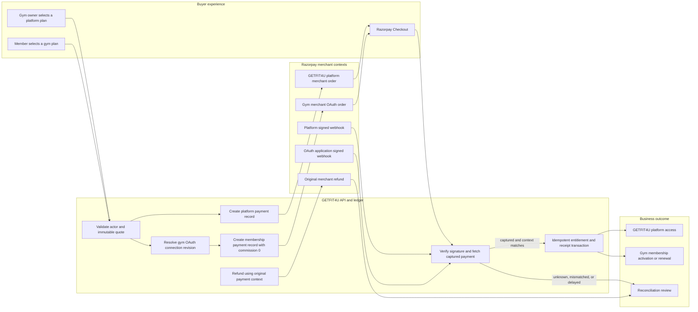

# Razorpay merchant OAuth payments

This release keeps two seller contexts separate. GETFIT4U platform fees use the GETFIT4U merchant account. New gym memberships use the selected gym's Razorpay OAuth merchant account. Existing Route transfers remain historical/reconciliation records and are not created by the new membership checkout.

## Transaction flow



There is no edge from the gym membership path to the GETFIT4U platform merchant and no Route transfer in the new flow.

## Required server configuration

Use the actual public backend origin; the custom website domain is the frontend origin unless it also routes `/api` to the backend.

```dotenv
PAYMENT_PROVIDER=razorpay
RAZORPAY_MODE=test
RAZORPAY_PLATFORM_PAYMENTS_ENABLED=false
RAZORPAY_GYM_OAUTH_ENABLED=false
RAZORPAY_GYM_QR_ENABLED=false
RAZORPAY_ROUTE_ENABLED=false
RAZORPAY_SUBSCRIPTIONS_ENABLED=false
RAZORPAY_PLATFORM_KEY_ID=
RAZORPAY_PLATFORM_KEY_SECRET=
RAZORPAY_PLATFORM_ACCOUNT_ID=
RAZORPAY_PLATFORM_WEBHOOK_SECRET=
RAZORPAY_OAUTH_CLIENT_ID=
RAZORPAY_OAUTH_CLIENT_SECRET=
RAZORPAY_OAUTH_REDIRECT_URI=https://git-fit4-u.vercel.app/api/v1/payments/razorpay/oauth/callback
RAZORPAY_OAUTH_WEBHOOK_SECRET=
PAYMENT_TOKEN_ENCRYPTION_KEY=
PAYMENT_TOKEN_ENCRYPTION_KEY_VERSION=1
FRONTEND_URL=https://www.getfit4u.in
BACKEND_PUBLIC_URL=https://git-fit4-u.vercel.app
```

Generate `PAYMENT_TOKEN_ENCRYPTION_KEY` locally and save it only in the backend/Vercel secret store:

```powershell
node -e "console.log(require('crypto').randomBytes(32).toString('hex'))"
```

Do not rotate that value until all stored token envelopes have been re-encrypted under a new version.

## Razorpay dashboard setup

1. Obtain the approved Technology Partner application's development client.
2. Add the exact redirect URI `https://git-fit4-u.vercel.app/api/v1/payments/razorpay/oauth/callback`.
3. Configure platform merchant webhooks at `https://git-fit4-u.vercel.app/api/v1/webhooks/razorpay/platform` with a unique secret.
4. Configure partner OAuth application webhooks at `https://git-fit4-u.vercel.app/api/v1/webhooks/razorpay/oauth` with a different secret.
5. Subscribe the platform receiver to payment/refund events for platform-fee orders. Subscribe the OAuth receiver to payment/refund events, available account-status events and `account.app.authorization_revoked`.
6. Do not select Route transfer events for new membership payments; they are historical reconciliation only.
7. Keep flags false until callback, signatures, account evidence and sandbox checkout are verified.

OAuth consent does not prove KYC, payment eligibility or settlement readiness. Admin review records evidence and enables collection only after those dimensions are verified. QR remains disabled unless both the global flag and individual merchant capability are enabled.

## API endpoints

- `POST /api/v1/gyms/:gymId/payments/razorpay/connect`
- `GET /api/v1/payments/razorpay/oauth/callback`
- `GET /api/v1/gyms/:gymId/payments/razorpay/status`
- `POST /api/v1/gyms/:gymId/payments/razorpay/disconnect`
- `POST /api/v1/webhooks/razorpay/platform`
- `POST /api/v1/webhooks/razorpay/oauth`
- Existing checkout, status, verification, refund and receipt endpoints continue to resolve the immutable payment context server-side.

## Migration and rollback

1. Back up the database.
2. Run `npm run db:migrate-razorpay-oauth` for a dry-run report.
3. Review the number of legacy Route connections/payments.
4. Run `npm run db:migrate-razorpay-oauth -- --apply` to mark legacy connections and build additive indexes.
5. Deploy with all new flags false; verify the platform path, then one sandbox gym OAuth pilot.
6. Roll back by setting `RAZORPAY_GYM_OAUTH_ENABLED=false`. Do not delete financial records or rewrite provider identifiers.

## External release gates

- Razorpay Technology Partner approval and correct test/live client credentials.
- Redirect URI allowlisting for the exact deployed backend URL.
- Both webhook subscriptions and distinct secrets.
- Merchant activation and settlement evidence for each gym.
- Real Razorpay sandbox OAuth consent, Checkout capture, webhook, refund and disconnect tests.
- A deployed durable schedule for dormant token refresh and reconciliation. Request-time distributed refresh locking is implemented; hosting scheduler configuration remains an operator task.

