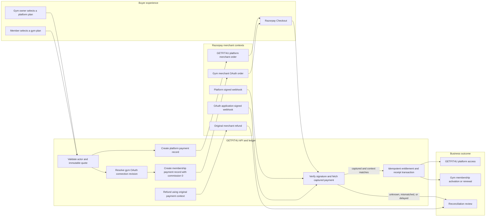

# Razorpay merchant OAuth payments

This release keeps two seller contexts separate. GETFIT4U platform fees use the GETFIT4U merchant account. New gym memberships use the selected gym's Razorpay OAuth merchant account. Existing Route transfers remain historical/reconciliation records and are not created by the new membership checkout.

## Transaction flow



There is no edge from the gym membership path to the GETFIT4U platform merchant and no Route transfer in the new flow.

## Required server configuration

Use the browser-facing API origin for the OAuth callback. The connection request sets a browser cookie that must also reach the callback. This frontend proxies `/api` through Vite locally and through the configured rewrite in production, so its callback uses the website origin. `BACKEND_PUBLIC_URL` and webhook URLs may still use the separately hosted backend.

```dotenv
PAYMENT_PROVIDER=razorpay
RAZORPAY_MODE=test
RAZORPAY_PLATFORM_PAYMENTS_ENABLED=false
RAZORPAY_GYM_OAUTH_ENABLED=false
RAZORPAY_GYM_QR_ENABLED=false
RAZORPAY_ROUTE_ENABLED=false
RAZORPAY_SUBSCRIPTIONS_ENABLED=false
RAZORPAY_PLATFORM_KEY_ID=
RAZORPAY_PLATFORM_KEY_SECRET=
RAZORPAY_PLATFORM_ACCOUNT_ID=
RAZORPAY_PLATFORM_WEBHOOK_SECRET=
RAZORPAY_OAUTH_CLIENT_ID=
RAZORPAY_OAUTH_CLIENT_SECRET=
RAZORPAY_OAUTH_REDIRECT_URI=https://www.getfit4u.in/api/v1/payments/razorpay/oauth/callback
RAZORPAY_OAUTH_WEBHOOK_SECRET=
PAYMENT_TOKEN_ENCRYPTION_KEY=
PAYMENT_TOKEN_ENCRYPTION_KEY_VERSION=1
FRONTEND_URL=https://www.getfit4u.in
BACKEND_PUBLIC_URL=https://git-fit4-u.vercel.app
```

Generate `PAYMENT_TOKEN_ENCRYPTION_KEY` locally and save it only in the backend/Vercel secret store:

```powershell
node -e "console.log(require('crypto').randomBytes(32).toString('hex'))"
```

Do not rotate that value until all stored token envelopes have been re-encrypted under a new version.

## Razorpay dashboard setup

1. Obtain the approved Technology Partner application's development client for integration testing. Use that client's ID and secret together; `RAZORPAY_MODE=test` does not select the development client automatically. Production clients require HTTPS callbacks and live mode.
2. Add the exact `RAZORPAY_OAUTH_REDIRECT_URI` to that same client's Redirect URIs. For the website at `https://www.getfit4u.in` with the same-origin API proxy, use `https://www.getfit4u.in/api/v1/payments/razorpay/oauth/callback`. The hostname, port, path and trailing slash must match the configured URI.
3. Configure platform merchant webhooks at `https://git-fit4-u.vercel.app/api/v1/webhooks/razorpay/platform` with a unique secret.
4. Configure partner OAuth application webhooks at `https://git-fit4-u.vercel.app/api/v1/webhooks/razorpay/oauth` with a different secret.
5. Subscribe the platform receiver to payment/refund events for platform-fee orders. Subscribe the OAuth receiver to payment/refund events, available account-status events and `account.app.authorization_revoked`.
6. Do not select Route transfer events for new membership payments; they are historical reconciliation only.
7. Keep flags false until callback, signatures, account evidence and sandbox checkout are verified.

OAuth consent does not prove KYC, payment eligibility or settlement readiness. Admin review records evidence and enables collection only after those dimensions are verified. QR remains disabled unless both the global flag and individual merchant capability are enabled.

### Local development

For the website opened at `http://localhost:5173`, use these backend settings and the development client's credentials:

```dotenv
FRONTEND_URL=http://localhost:5173
RAZORPAY_MODE=test
RAZORPAY_OAUTH_REDIRECT_URI=http://localhost:5173/api/v1/payments/razorpay/oauth/callback
```

Keep `COOKIE_DOMAIN` unset locally. The frontend's `VITE_DEV_API_TARGET` must point to the running local backend (currently `http://localhost:5001`). Register the following plain URL in the development client's Redirect URIs field, without quotes, query parameters or percent encoding:

```text
http://localhost:5173/api/v1/payments/razorpay/oauth/callback
```

Preserve other registered callbacks when adding it to a comma-separated list. Save successfully, reopen the application to confirm the URL persisted, restart the backend after configuration changes, and start a fresh Connect Razorpay attempt. Complete it within ten minutes. Do not reuse an old authorization URL or send a localhost-started callback to the separately hosted backend: that host will not receive the localhost browser cookie.

### Authorization troubleshooting

- **`Client authentication failed` on `auth.razorpay.com/authorize`:** Razorpay documents an incorrect `client_id` or `redirect_uri` as the cause. Confirm that the configured client ID belongs to the client whose redirect list you edited, and that the exact callback was saved. The client secret is used later during the server-side token exchange, not in this browser authorization request.
- **`Couldn't save application` in the Razorpay dashboard:** This generic dashboard message does not identify which setting failed. Development clients support localhost callbacks. In the dashboard's browser Network panel, inspect the failed Save request's HTTP status and error code/message. Check the selected client and the submitted URI list against those details; do not infer that localhost is prohibited or change the callback to another host to bypass the error. Share only the status and error fields when requesting help, never cookies, authorization headers or secrets.
- **`RAZORPAY_OAUTH_STATE_INVALID` from GETFIT4U:** The callback could not be matched to the initiating browser and pending authorization. Check the browser-facing callback host, cookie domain/path, expiry and whether the attempt was already used. Keep the state and browser-cookie validation enabled.

Official references: [Razorpay OAuth client and redirect setup](https://razorpay.com/docs/partners/technology-partners/onboard-businesses/integrate-oauth/integration-steps), [Razorpay OAuth errors](https://razorpay.com/docs/partners/technology-partners/onboard-businesses/integrate-oauth/errors).

## API endpoints

- `POST /api/v1/gyms/:gymId/payments/razorpay/connect`
- `GET /api/v1/payments/razorpay/oauth/callback`
- `GET /api/v1/gyms/:gymId/payments/razorpay/status`
- `POST /api/v1/gyms/:gymId/payments/razorpay/disconnect`
- `POST /api/v1/webhooks/razorpay/platform`
- `POST /api/v1/webhooks/razorpay/oauth`
- Existing checkout, status, verification, refund and receipt endpoints continue to resolve the immutable payment context server-side.

## Migration and rollback

1. Back up the database.
2. Run `npm run db:migrate-razorpay-oauth` for a dry-run report.
3. Review the number of legacy Route connections/payments.
4. Run `npm run db:migrate-razorpay-oauth -- --apply` to mark legacy connections and build additive indexes.
5. Deploy with all new flags false; verify the platform path, then one sandbox gym OAuth pilot.
6. Roll back by setting `RAZORPAY_GYM_OAUTH_ENABLED=false`. Do not delete financial records or rewrite provider identifiers.

## External release gates

- Razorpay Technology Partner approval and correct test/live client credentials.
- Redirect URI allowlisting for the exact browser-facing callback URL, with the initiating browser cookie available at that URL.
- Both webhook subscriptions and distinct secrets.
- Merchant activation and settlement evidence for each gym.
- Real Razorpay sandbox OAuth consent, Checkout capture, webhook, refund and disconnect tests.
- A deployed durable schedule for dormant token refresh and reconciliation. Request-time distributed refresh locking is implemented; hosting scheduler configuration remains an operator task.

