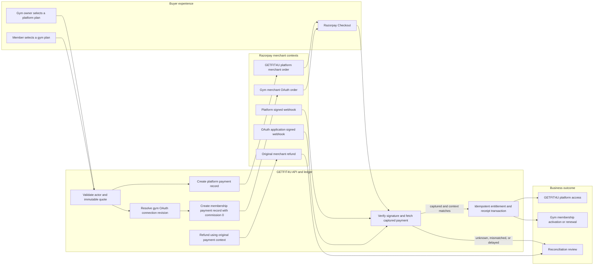

# Razorpay merchant OAuth payments

This release keeps two seller contexts separate. GETFIT4U platform fees use the GETFIT4U merchant account. New gym memberships use the selected gym's Razorpay OAuth merchant account. Existing Route transfers remain historical/reconciliation records and are not created by the new membership checkout.

## Transaction flow



There is no edge from the gym membership path to the GETFIT4U platform merchant and no Route transfer in the new flow.

## Required server configuration

Prefer the browser-facing API origin for the OAuth callback when registering a new URI. This frontend proxies `/api` through Vite locally and through its Vercel rewrite in production. If an already registered callback uses the standalone backend domain, the backend now relays it once to the saved browser-facing API origin to recover the original cookie. It never creates a replacement cookie on the relay or exchanges a code before that cookie and the stored attempt are verified.

The configured deployment was checked on 2026-11-17: `frontend/vercel.json` routes `/api/v1/*` to `https://git-fit4-u-un7d.vercel.app/api/v1/*`, and that backend's `/health` returned 200. The website API returned a Vercel Security Checkpoint to automated requests; a browser verification of production routing remains necessary.

```dotenv
PAYMENT_PROVIDER=razorpay
RAZORPAY_MODE=test
RAZORPAY_PLATFORM_PAYMENTS_ENABLED=false
RAZORPAY_GYM_OAUTH_ENABLED=false
RAZORPAY_GYM_QR_ENABLED=false
RAZORPAY_ROUTE_ENABLED=false
RAZORPAY_SUBSCRIPTIONS_ENABLED=false
RAZORPAY_PLATFORM_KEY_ID=
RAZORPAY_PLATFORM_KEY_SECRET=
RAZORPAY_PLATFORM_ACCOUNT_ID=
RAZORPAY_PLATFORM_WEBHOOK_SECRET=
RAZORPAY_OAUTH_CLIENT_ID=
RAZORPAY_OAUTH_CLIENT_SECRET=
RAZORPAY_OAUTH_REDIRECT_URI=https://www.getfit4u.in/api/v1/payments/razorpay/oauth/callback
RAZORPAY_OAUTH_WEBHOOK_SECRET=
PAYMENT_TOKEN_ENCRYPTION_KEY=
PAYMENT_TOKEN_ENCRYPTION_KEY_VERSION=1
FRONTEND_URL=https://www.getfit4u.in
BACKEND_PUBLIC_URL=https://git-fit4-u-un7d.vercel.app
```

Generate `PAYMENT_TOKEN_ENCRYPTION_KEY` locally and save it only in the backend/Vercel secret store:

```powershell
node -e "console.log(require('crypto').randomBytes(32).toString('hex'))"
```

Do not rotate that value until all stored token envelopes have been re-encrypted under a new version.

## Razorpay dashboard setup

1. Obtain the approved Technology Partner application's development client for integration testing. Use that client's ID and secret together; `RAZORPAY_MODE=test` does not select the development client automatically. Production clients require HTTPS callbacks and live mode.
2. Add the exact `RAZORPAY_OAUTH_REDIRECT_URI` to that same client's Redirect URIs. For the website at `https://www.getfit4u.in` with the same-origin API proxy, use `https://www.getfit4u.in/api/v1/payments/razorpay/oauth/callback`. The hostname, port, path and trailing slash must match the configured URI.
3. Configure platform merchant webhooks at `https://git-fit4-u-un7d.vercel.app/api/v1/webhooks/razorpay/platform` with a unique secret.
4. Configure partner OAuth application webhooks at `https://git-fit4-u-un7d.vercel.app/api/v1/webhooks/razorpay/oauth` with a different secret.
5. Subscribe the platform receiver to payment/refund events for platform-fee orders. Subscribe the OAuth receiver to payment/refund events, available account-status events and `account.app.authorization_revoked`.
6. Do not select Route transfer events for new membership payments; they are historical reconciliation only.
7. Keep flags false until callback, signatures, account evidence and sandbox checkout are verified.

OAuth consent does not prove KYC, payment eligibility or settlement readiness. Admin review records evidence and enables collection only after those dimensions are verified. QR remains disabled unless both the global flag and individual merchant capability are enabled.

### Local development

For the website opened at `http://localhost:5173`, use these backend settings and the development client's credentials:

```dotenv
FRONTEND_URL=http://localhost:5173
RAZORPAY_MODE=test
RAZORPAY_OAUTH_REDIRECT_URI=http://localhost:5173/api/v1/payments/razorpay/oauth/callback
```

Keep `COOKIE_DOMAIN` unset locally. The frontend's `VITE_DEV_API_TARGET` must point to the running local backend (currently `http://localhost:5001`). Register the following plain URL in the development client's Redirect URIs field, without quotes, query parameters or percent encoding:

```text
http://localhost:5173/api/v1/payments/razorpay/oauth/callback
```

Preserve other registered callbacks when adding it to a comma-separated list. Save successfully, reopen the application to confirm the URL persisted, restart the backend after configuration changes, and start a fresh Connect Razorpay attempt. Complete it within ten minutes. Local initiation and callback must reach the same Mongo database and OAuth configuration. A callback to a production backend cannot complete a local attempt unless that deployment deliberately shares that configuration; use the local callback above for local testing.

### OAuth state fix and deployment

**Follow-up network evidence (2026-11-17):** Razorpay's `POST /authorize` returned 302 and sent the browser back with a code/state. GETFIT4U's standalone callback returned JSON 403 with request ID `15eebde7-401e-4342-a847-68f01882912a`; no Cookie header was present in the supplied callback request. A separate read-only probe of the callback without code/state reproduced the old `RAZORPAY_OAUTH_STATE_INVALID` JSON response, with no redirect. The updated handler returns 303, `Cache-Control: no-store` and `X-Getfit4u-OAuth-Flow: 2` instead. The working-tree changes were not yet in Git's current commit, so redeploying that old source does not include the fix.

The frontend now checks the authenticated status endpoint's `oauthFlowVersion` before creating an attempt and checks it again in the initiation response. An older/mixed backend shows an update-required message before leaving GETFIT4U. Localhost-to-public callback mixtures also fail before creating state; use an entirely local configuration or the production website and backend together. Editing local `.env` files cannot update Vercel's environment or deployed source.

After publishing the updated backend source to the branch used by the backend Vercel project, deploy that new revision. Deploy the corresponding frontend revision too. The repository's backend project root is `backend`; the frontend project root is `frontend`. Verify the deployed source revision includes `backend/src/services/razorpayOAuthFlow.ts` before retesting. Keep existing secrets when applying the public URL settings in `backend/production.env.example`.

Verify the actual deployment from `backend`:

```text
npm run check:razorpay-deployment -- https://git-fit4-u-un7d.vercel.app/api/v1/payments/razorpay/oauth/callback
```

The check sends no code/state and changes no accounts. `updatedHandlerDeployed: true` confirms the new callback response is reachable; it is not a live OAuth or payment test. If it reports the old handler, the new source is not serving that URL yet. Vercel configuration changes require a new deployment; see [Vercel deployment management](https://vercel.com/docs/deployments/managing-deployments).

The former callback checked a single `gfu_rzp_oauth` cookie before any token exchange. Starting through the website proxy created that host-only cookie on the website; a direct callback to the unrelated Vercel backend could not receive it. Both a missing cookie and an absent/expired/mismatched attempt produced the same `RAZORPAY_OAUTH_STATE_INVALID` response. A second initiation also overwrote the single cookie. The idempotency header was validated but not used to deduplicate stored attempts. These failure paths were reproduced in regression tests. No local logs were available for request `189f1dd8-8e0e-4fa3-9a49-51cb9b5399e4`, and production logs were not accessible, so its precise historical failure reason is unconfirmed.

The new flow persists the state/nonce hashes, owner, gym, session, OAuth client hash, mode, exact redirect URI, browser API origin, timestamps and status in Mongo. A per-attempt host-only HttpOnly cookie avoids cross-tab overwrites. Its Secure flag follows the browser-facing HTTPS origin and SameSite is Lax. The callback enforces expiry itself, revalidates owner access and the initiating session, then atomically claims the attempt. A cross-domain return relays once to the stored trusted API origin and still requires the original cookie. The encrypted connection and successful attempt are committed in one Mongo transaction. A connection changed since initiation cannot be overwritten by a stale attempt.

1. Before enabling the new backend code, run `npm run db:prepare-razorpay-oauth` in `backend` against the deployment's Mongo database. This only creates OAuth-attempt indexes, including unique state and initiation-key hashes. It does not rewrite connections or payments. Use a replica set/Atlas deployment with transaction support.
2. Deploy both backend and frontend changes. Keep production `FRONTEND_URL=https://www.getfit4u.in`, `BACKEND_PUBLIC_URL=https://git-fit4-u-un7d.vercel.app`, `NODE_ENV=production`, and `RAZORPAY_GYM_OAUTH_ENABLED=true`. Use `RAZORPAY_MODE=live` for the approved live client pair; use a separate test environment and development client for verification. Keep the frontend API on its existing same-origin rewrite (`VITE_API_URL` empty).
3. Set `RAZORPAY_OAUTH_REDIRECT_URI` to the exact URI already saved for that client. Either `https://www.getfit4u.in/api/v1/payments/razorpay/oauth/callback` or `https://git-fit4-u-un7d.vercel.app/api/v1/payments/razorpay/oauth/callback` is supported. If the latter is already registered, it can remain registered: the new relay handles the browser cookie securely. Do not append a trailing slash, code, state or query parameters. Keep `COOKIE_DOMAIN` unset for this proxy deployment; OAuth uses its own host-only cookies.
4. All instances must share `MONGO_URI`, the same OAuth client ID/secret, mode, redirect URI, `FRONTEND_URL`, `PAYMENT_TOKEN_ENCRYPTION_KEY` and its version. Preserve the existing encryption key. Local presence checks found the OAuth credentials, webhook secret and encryption key configured; deployed secret values and cross-instance consistency still require operator verification. `MONGO_URI` is the actual variable name (not `MONGODB_URI`).
5. Confirm `CLIENT_ORIGIN` includes `https://www.getfit4u.in`. The non-www site redirects to www; start on www. Confirm the API rewrite and `/razorpay-connection-result` SPA route work in a real browser and that Vercel security rules permit the OAuth callback/relay. Do not disable state validation or broadly disable site protection.
6. Begin a new Connect attempt after deployment. Pre-upgrade attempts intentionally fail closed because they lack the new client/origin binding. The result page's **Connect again** posts a fresh authenticated initiation; it never reopens a previous callback. Success is displayed only after an authenticated lookup verifies this specific stored attempt and connection.

Safe application diagnostics use `event=razorpay_oauth`, `requestId`, `initiationRequestId`, `attemptId` and a fixed reason such as `missing_state`, `malformed_state`, `expired_state`, `attempt_not_found`, `browser_binding_failed`, `configuration_binding_failed`, `attempt_already_processed`, `owner_context_changed` or `token_exchange_failed`. No state, authorization code, token, secret or full callback query is logged by the application. Check hosting access-log redaction separately. An uncertain database commit remains PROCESSING for verification and does not revoke a potentially persisted token.

Verification commands: `npm test -- src/services/razorpayOAuthFlow.test.ts src/config/razorpayOAuth.test.ts src/integrations/payments/razorpayOAuthProvider.test.ts`, `npm run test:razorpay-oauth` (creates/removes an isolated database; provider transport mocked), and both projects' `npm run build` / `npm run lint`. The isolated suite exercises real Mongo indexes and transactions across two Express server instances. No real payment or Razorpay consent is performed by these checks.

Latest verification on 2026-11-17: 64 focused backend OAuth/configuration tests; 11 frontend OAuth tests; 7 isolated Mongo checks; both production builds and lint checks. The temporary databases were removed after testing. The deployment probe against the public backend still reported `updatedHandlerDeployed: false` and the old JSON 403. Production deployment, production index preparation, live consent and the Razorpay dashboard Save operation were not performed.

### Files changed for the OAuth fix

| Area | Files |
| --- | --- |
| Backend flow and routes | `backend/src/services/razorpayOAuthFlow.ts`, `backend/src/controllers/razorpayOAuthController.ts`, `backend/src/routes/razorpayConnectionRoutes.ts` |
| State and configuration | `backend/src/models/Business.ts`, `backend/src/config/razorpayOAuth.ts`, `backend/src/config/env.ts`, `backend/src/integrations/payments/razorpayOAuthProvider.ts`, `backend/.env.example` |
| Backend API and scripts | `backend/src/docs/openapi.ts`, `backend/src/scripts/prepare-razorpay-oauth-indexes.ts`, `backend/src/scripts/check-razorpay-oauth.ts`, `backend/src/scripts/check-razorpay-oauth-deployment.ts`, `backend/production.env.example`, `backend/package.json` |
| Frontend flow | `frontend/src/services/razorpayConnection.ts`, `frontend/src/components/RazorpayOAuthSettings.tsx`, `frontend/src/pages/owner/RazorpayConnectionResult.tsx`, `frontend/src/App.tsx` |
| Tests | `backend/src/services/razorpayOAuthFlow.test.ts`, `backend/src/config/razorpayOAuth.test.ts`, `backend/src/integrations/payments/razorpayOAuthProvider.test.ts`, `frontend/src/components/RazorpayOAuthSettings.test.tsx`, `frontend/src/pages/owner/RazorpayConnectionResult.test.tsx` |
| Deployment guide | `docs/RAZORPAY_OAUTH_PAYMENTS.md` |

### Authorization troubleshooting

- **`Client authentication failed` on `auth.razorpay.com/authorize`:** Razorpay documents an incorrect `client_id` or `redirect_uri` as the cause. Confirm that the configured client ID belongs to the client whose redirect list you edited, and that the exact callback was saved. The client secret is used later during the server-side token exchange, not in this browser authorization request.
- **`Couldn't save application` in the Razorpay dashboard:** This generic dashboard message does not identify which setting failed. Development clients support localhost callbacks. In the dashboard's browser Network panel, inspect the failed Save request's HTTP status and error code/message. Check the selected client and the submitted URI list against those details; do not infer that localhost is prohibited or change the callback to another host to bypass the error. Share only the status and error fields when requesting help, never cookies, authorization headers or secrets.
- **`RAZORPAY_OAUTH_STATE_INVALID` from GETFIT4U:** The callback could not be matched to the initiating browser and pending authorization. Check the browser-facing callback host, cookie domain/path, expiry and whether the attempt was already used. Keep the state and browser-cookie validation enabled.

Official references: [Razorpay OAuth client and redirect setup](https://razorpay.com/docs/partners/technology-partners/onboard-businesses/integrate-oauth/integration-steps), [Razorpay OAuth errors](https://razorpay.com/docs/partners/technology-partners/onboard-businesses/integrate-oauth/errors).

## API endpoints

- `POST /api/v1/gyms/:gymId/payments/razorpay/connect`
- `GET /api/v1/payments/razorpay/oauth/callback`
- `GET /api/v1/payments/razorpay/oauth/attempts/:reference` (authenticated owner/session/gym only)
- `GET /api/v1/gyms/:gymId/payments/razorpay/status`
- `POST /api/v1/gyms/:gymId/payments/razorpay/disconnect`
- `POST /api/v1/webhooks/razorpay/platform`
- `POST /api/v1/webhooks/razorpay/oauth`
- Existing checkout, status, verification, refund and receipt endpoints continue to resolve the immutable payment context server-side.

## Migration and rollback

1. Back up the database.
2. Run `npm run db:migrate-razorpay-oauth` for a dry-run report.
3. Review the number of legacy Route connections/payments.
4. Run `npm run db:migrate-razorpay-oauth -- --apply` to mark legacy connections and build additive indexes.
5. Deploy with all new flags false; verify the platform path, then one sandbox gym OAuth pilot.
6. Roll back by setting `RAZORPAY_GYM_OAUTH_ENABLED=false`. Do not delete financial records or rewrite provider identifiers.

## External release gates

- Razorpay Technology Partner approval and correct test/live client credentials.
- Redirect URI allowlisting for the exact browser-facing callback URL, with the initiating browser cookie available at that URL.
- Both webhook subscriptions and distinct secrets.
- Merchant activation and settlement evidence for each gym.
- Real Razorpay sandbox OAuth consent, Checkout capture, webhook, refund and disconnect tests.
- A deployed durable schedule for dormant token refresh and reconciliation. Request-time distributed refresh locking is implemented; hosting scheduler configuration remains an operator task.

